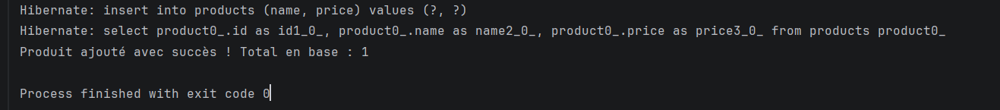
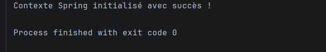

## Résultats

### Image 1 : Exécution de `MainApp`

Cette capture montre l'ajout d'un produit via la couche service. Hibernate exécute un `insert` pour enregistrer le produit « Microservice Gateway » dans la table `products`, puis un `select` pour récupérer la liste des produits. Le message **« Produit ajouté avec succès ! Total en base : 1 »** confirme que l'insertion a réussi, et `exit code 0` indique que le programme s'est terminé sans erreur.

### Image 2 : Exécution de `TestHibernate`

Cette capture vérifie la configuration du projet. Le message **« Contexte Spring initialisé avec succès ! »** prouve que le conteneur Spring démarre correctement, que la `SessionFactory` Hibernate est créée et que la connexion à la base `product_db` fonctionne. `exit code 0` confirme l'absence d'erreur.